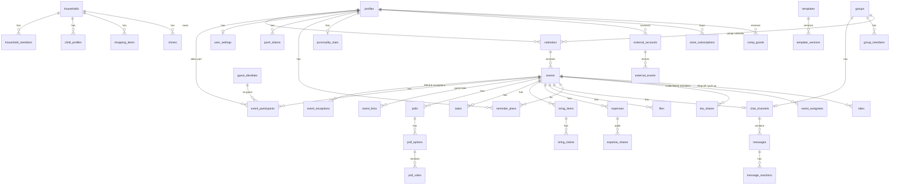

# Datenmodell (ERD) & RLS-Konzept

> **Status:** v0.1 · 2026-11-03 · Logisches Modell aus Phase 0, **noch keine Migrationen**. Spaltenlisten
> sind nicht vollständig; endgültige Typen/Indizes entstehen mit den Migrationen der jeweiligen Phase.

## 1. Konventionen

- Primärschlüssel `id uuid` (UUID v7, zeitlich sortierbar). `created_at`, `updated_at` (`timestamptz`),
  Tombstone `deleted_at` bei sync-relevanten Tabellen.
- Zeit: `timestamptz` (UTC) + `tz text` (IANA). Ganztags: `start_date date`, `end_date date`.
- Geld: `amount_minor bigint` + `currency char(3)`.
- Enums als Postgres-Enums, synchron mit TS (Test).
- Jede Tabelle: `alter table … enable row level security;` + explizite Policies. Keine Tabelle ohne Policy-Test.

## 2. ERD (Kern)



## 3. Tabellen nach Domäne

### Identität & Konto

| Tabelle | Wichtige Spalten | Hinweise |
| --- | --- | --- |
| `auth.users` | (Supabase) | Identitäten/Provider verwaltet Supabase Auth |
| `profiles` | `id = auth.users.id`, `display_name`, `avatar_path`, `pronouns`, `age_confirmed_at`, `locale`, `status` (`active`,`suspended`,`pending_deletion`) | **Kein Geburtsdatum.** Nutzer kann nur `display_name`, `avatar_path`, `pronouns`, `locale` ändern (Column-Grants) |
| `user_settings` | Theme, 12/24 h, Wochenstart, Erinnerungston, Ruhezeiten, Fokus-Modus, `dawdle_mode` | nur Eigentümer |
| `push_tokens` | `user_id`, `device_id`, `token`, `platform`, `last_seen_at` | nur Eigentümer |
| `consents` | `user_id`, `kind` (`crash_reports`,`live_eta`,`ai`…), `granted_at`, `revoked_at`, `version` | Historie bleibt (Nachweis) |
| `account_requests` | `user_id`, `kind` (`export`,`deletion`), `status`, `due_at` | Löschung nach 30 Tagen via pg_cron |

### Kalender & Events

| Tabelle | Wichtige Spalten | Hinweise |
| --- | --- | --- |
| `calendars` | `owner_kind` (`user`,`household`,`group`), `owner_id`, `name`, `color_token`, `is_default` | |
| `events` | `calendar_id`, `kind` (`appointment`,`social`), `title`, `description`, `start_at`, `end_at`, `tz`, `all_day`, `rrule`, `location_id`, `category`, `status`, `visibility` (`private`,`link`,`group`), `capacity`, `maybe_deadline`, `prep_minutes`, `arrival_margin_minutes`, `template_version_id`, `host_id` | Persönlicher Termin und soziales Event in **einer** Tabelle → eine Zeitachse, ein Erinnerungssystem |
| `event_exceptions` | `event_id`, `original_start_at`, `kind` (`cancelled`,`modified`), überschriebene Felder | RRULE-Ausnahmen |
| `event_participants` | `event_id`, `user_id` **oder** `guest_id`, `role` (`host`,`cohost`,`guest`), `rsvp` (`pending`,`yes`,`maybe`,`no`,`no_response`,`waitlist`), `plus_ones`, `note`, `rsvp_at`, `removed_at` | Check-Constraint: genau eins von `user_id`/`guest_id` |
| `event_links` | `event_id`, `token_hash bytea`, `expires_at`, `pin_hash`, `revoked_at`, `created_by` | Token nie im Klartext |
| `guest_identities` | `display_name`, `email` (optional, verifiziert), `converted_user_id` | Löschung 90 Tage nach Event-Ende, wenn nicht konvertiert |
| `locations` | `label`, `address`, `lat`, `lng`, `provider_place_id`, `meeting_point_note`, `transit_note` | Event-Orte (nicht Nutzer-Standorte) |
| `polls` / `poll_options` / `poll_votes` | Typ, `deadline_at`, `decision_mode` (`majority`,`host`), `anonymous`; Vote: `voter_user_id`/`voter_guest_id`, `value` (`yes`,`maybe`,`no`) | Anonym: Votes nur über aggregierende Funktion lesbar |
| `tasks` | `event_id`/`group_id`/`household_id`, `title`, `due_at`, `assignee_user_id`, `done_at` | |
| `bring_items` / `bring_claims` | Item: `name`, `normalized_name`, `quantity`, `category`; Claim: `user_id`/`guest_id`, `quantity` | Summe Claims ≤ Menge (Funktion + Constraint-Trigger) |
| `expenses` / `expense_shares` / `settlements` | `amount_minor`, `currency`, `paid_by`, Anteile, Ausgleich bestätigt von beiden | Phase 9 |
| `files` | `event_id`, `uploader_id`, `storage_path`, `mime`, `size_bytes`, `status` (`pending`,`ready`,`rejected`) | Speicher-Quota per View summiert |
| `templates` / `template_versions` | `slug`, `tier_min`, Inhalte DE/EN als JSON (validiert per zod) | Admin-gepflegt + Nutzer-Vorlagen (`owner_id`) |

### Kommunikation

| Tabelle | Wichtige Spalten | Hinweise |
| --- | --- | --- |
| `chat_channels` | `event_id` **oder** `group_id` **oder** `household_id` | |
| `messages` | `channel_id`, `author_user_id`/`author_guest_id`, `body`, `body_format`, `reply_to_id`, `is_pinned`, `is_important`, `edited_at`, `deleted_at`, `kind` (`user`,`system`) | `body` opak (E2E-fähig später) |
| `message_reactions` | `message_id`, `user_id`, `emoji` | |
| `channel_mutes` | `channel_id`, `user_id`, `until` | |
| `blocks` | `blocker_id`, `blocked_id` | |
| `reports` | `reporter_id`, `target_kind`, `target_id`, `reason`, `status`, `assigned_admin_id` | Admin-Moderation |

### Anti-Chaos-Engine

| Tabelle | Wichtige Spalten | Hinweise |
| --- | --- | --- |
| `reminder_plans` | `user_id`, `event_id`, `occurrence_start_at`, `travel_mode`, `travel_minutes`, `travel_source` (`manual`,`routing`), `stages jsonb`, `leave_at` | pro Nutzer & Vorkommen; Gerät plant lokal |
| `ready_check_items` | `user_id`, `event_id` (null = Standard), `label`, `source` (`bring`,`file`,`template`,`custom`), `checked_at` | |
| `departure_signals` | `user_id`, `event_id`, `leave_at`, `departed_at` | Basis für Puffer-EWMA; 180 Tage Aufbewahrung |
| `punctuality_stats` | `user_id`, `dawdle_buffer_minutes`, Monatsaggregate | nur Eigentümer |
| `eta_shares` | `user_id`, `event_id`, `eta_at`, `expires_at`, `stopped_at` | **keine Koordinaten**; Löschung bei Ablauf + 1 h |
| `late_notices` | `user_id`, `event_id`, `minutes_late`, `created_at` | erscheint als Systemnachricht |

### Familie & Gruppen

| Tabelle | Wichtige Spalten | Hinweise |
| --- | --- | --- |
| `households` | `name`, `admin_user_id` | max. 1 pro Nutzer (Unique auf `household_members.user_id`) |
| `household_members` | `household_id`, `user_id`, `role` (`admin`,`adult`) | |
| `child_profiles` | `household_id`, `display_name`, `color_token`, `emoji` | **kein Login, kein Geburtsdatum, kein Foto** |
| `event_assignees` | `event_id`, `child_profile_id`/`user_id` | „Für wen ist der Termin?“ |
| `rides` | `event_id`, `occurrence_start_at`, `kind` (`drop_off`,`pick_up`), `driver_user_id` | |
| `shopping_items`, `chores` | Haushaltslisten, Rotation | |
| `groups` / `group_members` | `name`, `join_mode`; Mitglied `role` (`admin`,`member`) | |
| `group_links` | wie `event_links` | |

### Externe Kalender

| Tabelle | Wichtige Spalten | Hinweise |
| --- | --- | --- |
| `external_accounts` | `user_id`, `provider`, `vault_secret_id`, `scopes`, `status`, `sync_cursor` | Tokens nur im **Vault** |
| `external_events` | `external_account_id`, `external_id`, `start_at`, `end_at`, `busy`, `title_encrypted` | Busy-Overlay liest nur `start_at`/`end_at`/`busy` über eine Funktion |

### Monetarisierung & Betrieb

| Tabelle | Wichtige Spalten | Hinweise |
| --- | --- | --- |
| `store_subscriptions` | `user_id`, `provider` (`app_store`,`play`), `product_id`, `tier`, `status`, `period_end`, `is_trial`, `rc_app_user_id` | nur über Webhook geschrieben |
| `comp_grants` | `user_id`, `tier`, `starts_at`, `ends_at`, `reason`, `note`, `granted_by`, `revoked_at` | Admin |
| `entitlements` (View) | `user_id`, `effective_tier`, `source` | max(Store, Comp, Family-Mitgliedschaft) |
| `system_settings` | Feature-Flags, Remote-Config (`key`, `value jsonb`) | lesbar für Clients über Funktion, schreibbar nur Admin |
| `house_ads`, `house_ad_variants`, `ad_slots`, `ad_stats_daily` | Kampagnen, Slots, aggregierte Zähler | **keine Nutzer-ID in Statistiken** |
| `announcements` | In-App-News | |
| `admin_users` | `user_id`, `role` (`super_admin`,`admin`,`support`,`content_editor`,`read_only`) | |
| `audit_log` | `actor_id`, `action`, `target_kind`, `target_id`, `before jsonb`, `after jsonb`, `reason`, `created_at` | **append-only** (kein Update/Delete, auch nicht für service_role außer Retention-Job) |
| `rate_limits` | `key`, `tokens`, `refilled_at` | |

## 4. RLS-Konzept

### 4.1 Hilfsfunktionen (alle `security definer`, `set search_path = ''`, `stable`)

```sql
-- Beispiele (Entwurf, keine Migration)
create function public.is_event_member(p_event_id uuid) returns boolean
  language sql stable security definer set search_path = '' as $$
  select exists (
    select 1 from public.event_participants ep
    where ep.event_id = p_event_id and ep.user_id = (select auth.uid())
      and ep.removed_at is null    -- Absage („Nein“) behält Lesezugriff, siehe 4.3
  ) or exists (
    select 1 from public.events e
    join public.calendars c on c.id = e.calendar_id
    where e.id = p_event_id and public.can_read_calendar(c.id)
  );
$$;

create function public.event_role(p_event_id uuid) returns public.event_role ...;
create function public.can_read_calendar(p_calendar_id uuid) returns boolean ...;  -- user/household/group
create function public.is_household_member(p_household_id uuid) returns boolean ...;
create function public.is_group_member(p_group_id uuid) returns boolean ...;
create function public.is_admin(p_min_role public.admin_role) returns boolean ...; -- prüft auch AAL2
```

`(select auth.uid())` statt `auth.uid()` in Policies, damit Postgres den Wert pro Query nur einmal auswertet.
Die Funktionen sind für `authenticated` ausführbar, für `anon` nicht.

### 4.2 Policy-Matrix (Kurzform)

| Tabelle | SELECT | INSERT | UPDATE | DELETE |
| --- | --- | --- | --- | --- |
| `profiles` | eigene + Profile von Personen mit gemeinsamem Event/Gruppe/Haushalt (nur `display_name`, `avatar_path` über View `public_profiles`) | – (Trigger bei Signup) | eigene, nur erlaubte Spalten | – (über Löschprozess) |
| `events` | `is_event_member` oder `can_read_calendar` | über RPC `create_event` (prüft Limits) | Host/Co-Host (Spalten-Whitelist) | nur Host über RPC |
| `event_participants` | Mitglieder des Events (Gästeliste-Sichtbarkeit beachtet) | über RPC `invite`, `respond` | eigene RSVP-Spalten; Rollen nur Host über RPC | Host, oder eigener Austritt |
| `event_links` | Host/Co-Host (ohne `token_hash`) | RPC | RPC (Widerruf) | – |
| `messages` | Mitglieder des Kanals, nicht `deleted_at`-Inhalte, Blocks ausgefiltert | Mitglieder (Rate-Limit-Trigger) | Autor (15 Min., nur `body`) / Host (`is_pinned`) | Autor oder Host (Soft-Delete) |
| `poll_votes` | nicht-anonym: Mitglieder; anonym: **niemand direkt** (nur `poll_results()`) | Mitglieder vor Deadline | eigene vor Deadline | eigene vor Deadline |
| `bring_claims`, `tasks` | Mitglieder | über RPC (atomar) | eigene / Host | eigene / Host |
| `child_profiles`, `rides`, `shopping_items` | Haushaltsmitglieder | Haushaltsmitglieder | Haushaltsmitglieder | Admin des Haushalts |
| `reminder_plans`, `departure_signals`, `punctuality_stats`, `ready_check_items` | **nur Eigentümer** | Eigentümer | Eigentümer | Eigentümer |
| `eta_shares` | Mitglieder des Events, solange `expires_at > now()` und nicht gestoppt | Eigentümer, nur wenn Event-Mitglied | Eigentümer (stoppen) | Eigentümer |
| `external_accounts` | Eigentümer (ohne Secret-ID) | nur Edge Function | nur Edge Function | Eigentümer (Trennen → Edge Function löscht Secret) |
| `store_subscriptions`, `comp_grants` | Eigentümer (lesen) | **nur service_role** | **nur service_role** | – |
| `system_settings` | über Funktion `client_config()` (nur freigegebene Keys) | Admin | Admin | Admin |
| `audit_log` | `is_admin('read_only')` | nur über Admin-Funktionen (gleiche Transaktion) | **niemand** | **niemand** (Retention-Job ausgenommen) |
| `house_ads` etc. | aktive Kampagnen über `ads_for_client()` (nur Free) | Admin (`content_editor`+) | Admin | Admin |

### 4.3 Festgelegte Detailregeln

- **Absage ≠ Rauswurf:** Wer „Nein“ sagt, behält Lesezugriff auf das Event (kann seine Meinung ändern), erhält aber
  keine Benachrichtigungen mehr außer bei Zeit-/Ortsänderung. Wer vom Host entfernt wird, verliert jeden Zugriff.
- **Gäste ohne Account** haben **keine** RLS-Identität. Alle Gast-Zugriffe laufen über `guest_*`-Funktionen, die nur
  von der Edge Function (service_role) aufgerufen werden dürfen und intern `event_id` + `guest_id` aus dem geprüften
  Token ableiten.
- **Limits** (Events, Teilnehmer, Speicher, Gruppen) werden in den RPCs gegen `entitlements` geprüft, nicht im Client.
- **Admin-Zugriff auf Inhalte** (Chat, Event-Details) nur über `admin_open_case(report_id, reason)`, das Zugriff
  zeitlich begrenzt freischaltet und ins Audit-Log schreibt.

### 4.4 Tests (pgTAP, ab Phase 2)

Für jede Tabelle mindestens: (1) Fremder Nutzer sieht nichts, (2) Mitglied sieht nur Erlaubtes, (3) Mitglied kann
geschützte Spalten nicht ändern, (4) `anon` hat keinen Zugriff, (5) Limit-Verletzung wird abgelehnt.
Dazu Nebenläufigkeitstests für Claims, Kapazität und Selbstzuweisung.

## 5. Datenlebenszyklus (Auszug)

| Daten | Aufbewahrung |
| --- | --- |
| Live-ETA | bis Ablauf + 1 h, dann gelöscht |
| Gast-Identitäten | 90 Tage nach Event-Ende, wenn nicht in Account umgewandelt |
| Losgeh-Signale | 180 Tage (Puffer-Lernen braucht nur jüngere Daten) |
| Account nach Löschantrag | 30 Tage Karenz, dann Löschung bzw. Anonymisierung von Chat-Beiträgen |
| Audit-Log | 2 Jahre (Begründung: Nachweispflichten; rechtlich prüfen) |
| Server-Logs | 14 Tage |
| Exporte | 24 h nach Erstellung |
