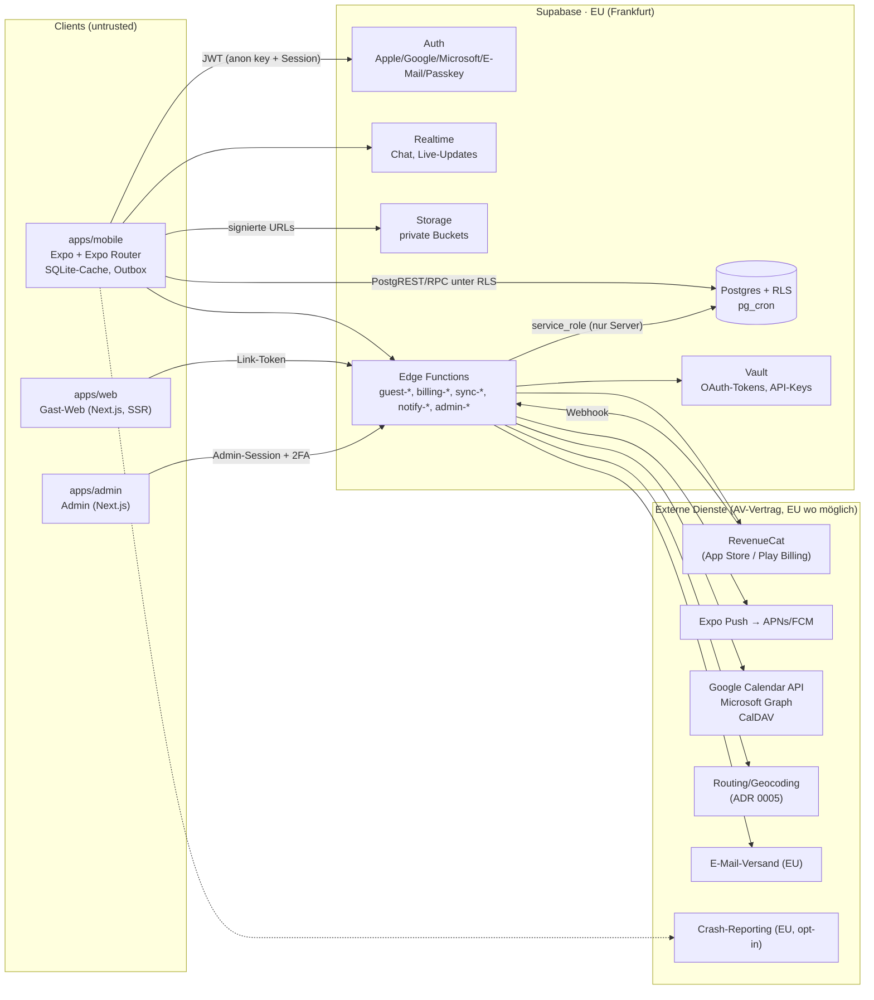

# Architektur-Überblick

> **Status:** v0.1 · 2026-11-03 · Zielarchitektur aus Phase 0, **noch nicht implementiert**.
> Begründungen: [ADR 0001](../decisions/0001-tech-stack.md), [ADR 0002](../decisions/0002-backend-supabase-eu.md).

## 1. Systembild



## 2. Vertrauensgrenzen

| Grenze | Regel |
| --- | --- |
| Mobile → DB | Nur `anon`-Key + Nutzer-JWT. Alles läuft unter RLS. Schreibzugriffe auf sensible Werte (Rollen, Entitlements, Limits) **nur über RPC/Edge Functions**, nie per direktem `insert/update` |
| Gast-Web → DB | **Kein** direkter DB-Zugriff. Nur Edge Functions `guest-*` prüfen Link-Token und Gast-Session und arbeiten dann mit eng begrenzten `security definer`-Funktionen |
| Admin → DB | Eigene Edge Functions `admin-*`, prüfen Admin-Rolle (`admin_users`) + 2FA-Status (AAL2) + schreiben Audit-Log in derselben Transaktion |
| Store → Server | RevenueCat-Webhook mit Shared-Secret-Header; Entitlements werden aus dem Webhook + RevenueCat-REST abgeleitet, nie aus Client-Angaben |
| Server → Drittanbieter | API-Keys nur in Edge-Function-Secrets/Vault; Proxy statt Direktzugriff vom Client |

## 3. Pakete (Monorepo)

Siehe Karte in [CLAUDE.md](../../CLAUDE.md). Wichtigste Verantwortlichkeiten:

- **`packages/domain`** (reines TS, Vitest): RRULE-Expansion, Zeitzonen, Konflikterkennung, Anti-Chaos-Rechner
  (Losgeh-Zeit, Stufenplan, Puffer-EWMA), Vote-Auswertung, Kosten-Split/Ausgleich, Duplikat-Erkennung
  (Mitbringliste), Vorlagen-Auflösung. **Wird auch in Edge Functions (Deno) verwendet** – daher keine
  Node-spezifischen APIs, nur ESM und Web-Standards.
- **`packages/entitlements`**: Stufen, Limits, Feature-Gates als Daten + Funktionen `canCreateEvent(state)` usw.
  Server (Edge Functions/SQL) ist die Wahrheit; SQL-Limits werden aus derselben Quelle generiert (Codegen →
  Migration), ein Test prüft die Gleichheit.
- **`packages/validation`**: zod-Schemas für alle RPC-/Edge-Function-Payloads (Client und Server).
- **`packages/i18n`**: ICU-Nachrichten de/en, Typen für Schlüssel, Test „keine fehlenden Schlüssel“.
- **`packages/ui`**, **`packages/brand`**, **`packages/config`**: siehe Design/Brand/Security.

## 4. Mobile-App (`apps/mobile`)

- **Expo** (aktuelles SDK zum Start von Phase 1 – Stand heute SDK 5x, wird in Phase 1 fixiert), Expo Router,
  New Architecture, Hermes. Dev-Client + EAS Build für iOS und Android parallel.
- **Struktur:** `app/` (dünne Routen, nur Re-Exports) · `features/<modul>/` (Screens, Hooks, Komponenten) ·
  `services/` (Expo-/Native-Zugriffe: Notifications, Location, Calendar, SecureStore) · `storage/` (SQLite) ·
  `api/` (Supabase-Client, Query-Keys).
- **State:** TanStack Query (Server-State, Cache) · Zustand (flüchtiger UI-State) · SQLite (persistente
  Offline-Kopie + Outbox).
- **Animation:** Reanimated, Gesture Handler, Skia nur lazy (Heatmap, Ringe, Konfetti), Lottie (House Ads, Logo-Animation).

### 4.1 Offline & Sync

```
UI ─► Query-Cache ◄─► SQLite (lokale Kopie: Kalender ±90 Tage, eigene Events, Aufgaben, Listen)
 │
 └─► Mutation ─► Outbox (SQLite, idempotency_key) ─► RPC/Edge Function ─► Postgres
                                   ▲ Retry mit Backoff, bei Online-Wechsel
Realtime / Pull (updated_at > cursor) ─► SQLite ─► Query-Invalidierung
```

- Jede Mutation hat einen `idempotency_key` (UUID v7), damit Wiederholungen nicht doppelt wirken.
- Konflikte: Server entscheidet. Für frei editierbare Felder gilt Last-Writer-Wins **pro Feld** (`field_updated_at`).
  Bei strukturellen Konflikten (z. B. Mitbring-Claim über Menge, Aufgabe schon übernommen) lehnt der Server ab,
  und die UI zeigt eine verständliche Meldung.
- Gelöschte Datensätze werden über Tombstones (`deleted_at`) synchronisiert und nach 30 Tagen bereinigt.

### 4.2 Benachrichtigungen

| Art | Quelle | Beispiel |
| --- | --- | --- |
| Lokal | Gerät (expo-notifications), offline-fähig | Anti-Chaos-Stufen, Aufgaben-Fälligkeit |
| Remote | Edge Function `notify-*` → Expo Push → APNs/FCM | Einladung, Chat, Änderung, Umfrage-Deadline |
| Silent | Server → Gerät | Neuplanung lokaler Stufen nach Zeit-/Ortsänderung |

Push-Tokens in `push_tokens` (pro Gerät, löschbar bei Logout). Push-Inhalte enthalten nur das Nötigste;
Option „Inhalte in Benachrichtigungen ausblenden“ im Datenschutz-Center.

### 4.3 Widgets & Live Activities

Phase 6 (Basis-Widget „Nächster Termin / Losgehen in …“). Erfordert native Targets (iOS WidgetKit, Android
App Widgets) über Expo Config Plugins. Live Activities/Live Updates: v2 – Machbarkeit mit dem dann aktuellen Expo SDK
in Phase 6 prüfen.

## 5. Backend (Supabase)

- **Postgres** mit RLS auf jeder Tabelle; Geschäftsregeln mit Mehrbenutzer-Konfliktpotenzial (Claims,
  Selbstzuweisung, Limits, RSVP-Kapazität) als **Postgres-Funktionen** in einer Transaktion.
- **pg_cron** für Fristen: Umfragen schließen, „Vielleicht“ ablaufen lassen, Löschfristen, Bereinigung Live-ETA,
  Trial-Erinnerungen.
- **Edge Functions** (Deno/TypeScript) für alles mit Secrets oder Drittanbietern:
  `guest-*` (Gast-Web), `billing-webhook` (RevenueCat), `sync-*` (Kalender), `places-*` (Geocoding/Routing-Proxy),
  `notify-*` (Push/E-Mail), `media-*` (Bild-Re-Encoding), `account-*` (Export/Löschung), `admin-*`.
- **Realtime:** Chat und Live-Updates (RSVP-Zähler, Listen) über Postgres Changes mit RLS bzw. private
  Broadcast-Kanäle mit Autorisierung.
- **Storage:** private Buckets `event-files`, `avatars`, `covers`, `exports`; Zugriff nur über signierte URLs.
- **Rate-Limiting:** Tabelle `rate_limits` (Token-Bucket pro Schlüssel) in Postgres für App-Aktionen
  + Limits der Supabase-Auth; für das Gast-Web zusätzlich IP-basierte Limits am Edge.

## 6. Gast-Web (`apps/web`) und Admin (`apps/admin`)

- **Getrennte Deployments** (unterschiedliche Angriffsflächen). Gast-Web: öffentlich, minimal, SSR, kein
  Supabase-Key mit Rechten im Browser (Anfragen über eigene Server-Routen → Edge Functions).
  Admin: separate Domain, Login nur für `admin_users`, Pflicht-2FA (Passkey/TOTP), IP-Allowlist optional.
- Hosting: EU-Region (Kandidaten: Vercel mit EU-Funktionsregion, Netlify EU, oder selbst gehostet bei einem
  EU-Anbieter). Entscheidung in Phase 4 (offene Frage an PO).

## 7. Kalender-Sync (Phase 7)

- Google: Calendar API mit OAuth (Scopes minimal; **App-Verifizierung durch Google nötig**), Push-Kanäle (Webhooks)
  + inkrementeller Sync-Token.
- Microsoft: Graph API mit Delta-Queries + Subscriptions.
- iCloud: CalDAV mit app-spezifischem Passwort **oder** auf iOS EventKit lokal (bevorzugt: keine Zugangsdaten auf
  unserem Server). Empfehlung: **EventKit lokal** für Apple-Nutzer, CalDAV nur als Ausnahme.
- Externe Termine werden als `external_events` gespiegelt (minimal: Zeit, Titel optional verschlüsselt, Busy-Flag),
  Tokens im Vault, Widerruf löscht Spiegel innerhalb 24 h.

## 8. Qualität & Betrieb

- **Tests:** Vitest (Pakete) · Jest + RNTL (App) · pgTAP (RLS, Funktionen, Fristen) · Maestro (E2E-Flows auf
  iOS-Simulator und Android-Emulator in CI) · Playwright (Gast-Web, Admin).
- **CI (GitHub Actions):** typecheck, lint, format, unit, pgTAP gegen lokale Supabase, Secret-Scan (z. B. gitleaks),
  `pnpm audit`, EAS Build iOS + Android, Maestro-Smoke.
- **Monitoring:** Crash-Reporting mit EU-Region, PII-Scrubbing, Opt-in wo erforderlich (siehe privacy.md).
  Server-Logs ohne Inhalte (keine Chat-Texte, keine Event-Titel), Aufbewahrung 14 Tage.

## 9. Offene Architekturfragen (werden in den Phasen entschieden)

| Frage | Phase | Optionen |
| --- | --- | --- |
| Zeit-Bibliothek | 3 | `Temporal`-Polyfill vs. `date-fns`/`date-fns-tz`; RRULE: `rrule` (BSD) vs. eigene Teilmengen-Implementierung |
| Lokale DB-Schicht | 1 | `expo-sqlite` direkt vs. Drizzle-ORM auf expo-sqlite |
| Routing/Geocoding-Anbieter | 6 | [ADR 0005](../decisions/0005-maps-routing-provider.md) |
| Bot-Schutz Gast-Web | 4 | Turnstile vs. Friendly Captcha vs. nur Rate-Limits |
| Malware-Scan Uploads | 5 | ClamAV-Service (EU) vs. Typ-Allowlist ohne Scan |
| Web-Hosting | 4 | siehe §6 |
